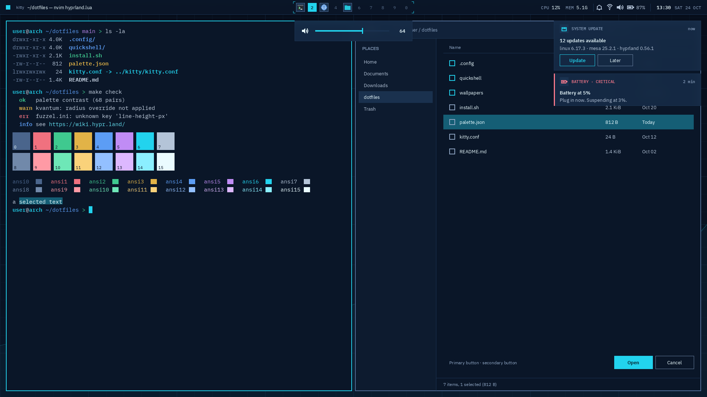
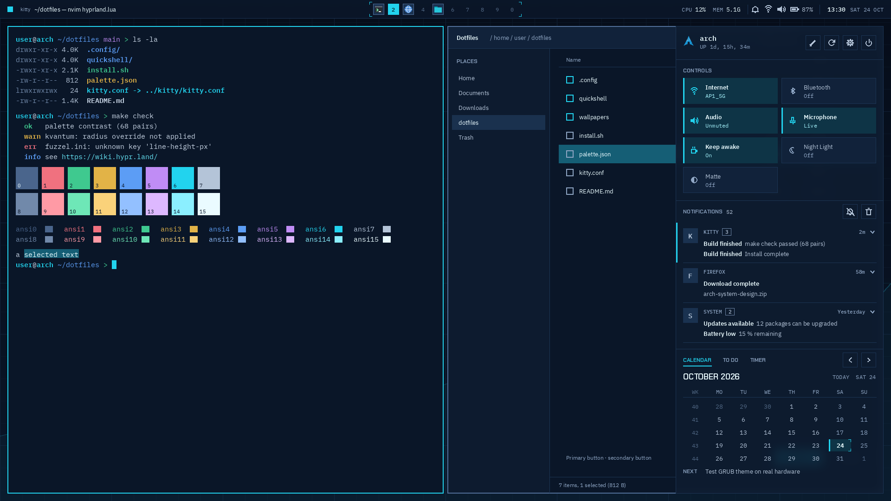
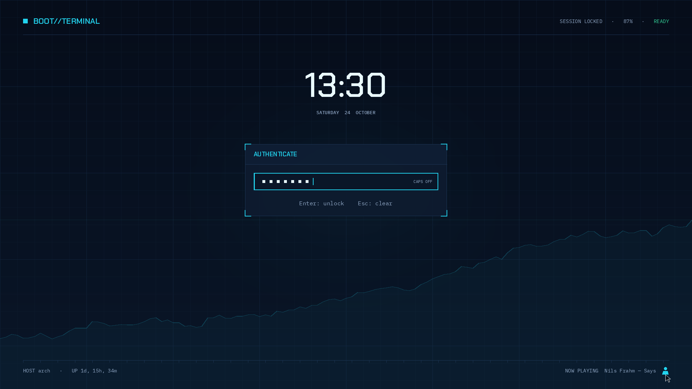
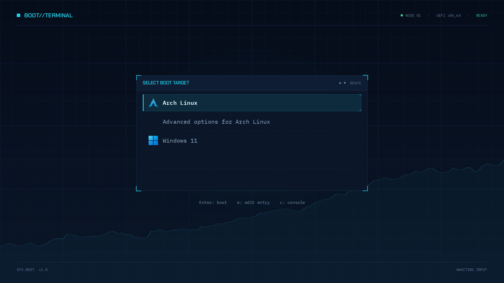
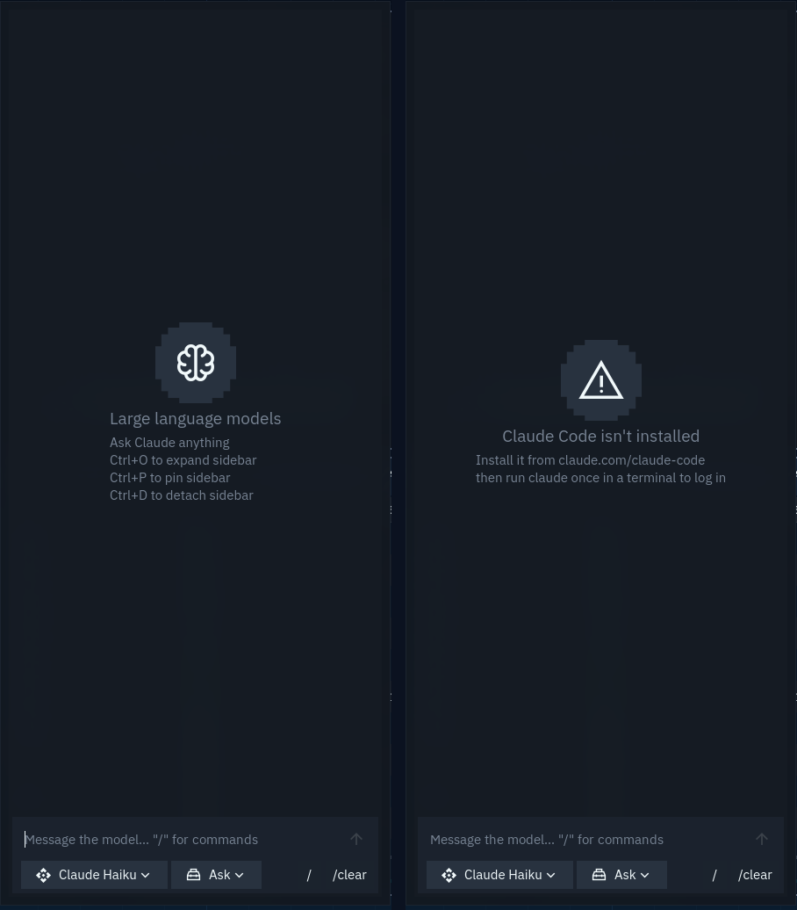

# Tickerline

A theme for [illogical-impulse](https://github.com/end-4/dots-hyprland), end-4's Hyprland dotfiles, plus a matching GRUB boot menu. Cyan on navy, square corners, monospace details, with a look borrowed from trading terminals and boot screens.

It's an add-on: you install illogical-impulse first, then run this on top. It doesn't fork ii. It patches a few of ii's files in place and replaces the bar and the right sidebar.



| Sidebar | Lock screen | Boot menu |
| --- | --- | --- |
|  |  |  |

These are the design mockups; the real thing is close to them.

The full reference (design rules, every color and size, how the scripts work) is in [docs/TICKERLINE.md](docs/TICKERLINE.md), also as an [OpenDocument file](docs/TICKERLINE.odt).

## What changes

- **Colors** come from a fixed palette (`desktop/palette.json`) instead of the wallpaper. Matugen is switched off, and the same colors go to ii, Hyprland, kitty, fuzzel, hyprlock, GTK and KDE/Qt apps.
- **Matte palette:** a calmer, lower-contrast variant for evenings. It has its own toggle in the quick panel (it replaces ii's Dark Mode toggle, since the theme is dark only). Night Light turns it on as well.
- **Shape and motion:** no rounded corners anywhere, 2 px borders, no shadows, one ease-out curve with no overshoot.
- **Top bar:** window title on the left, workspaces in a bracket frame in the middle (with the app icon of each busy workspace), system info and clock on the right.
- **Right sidebar:** quick tiles, notifications grouped per app, and Calendar / To Do / Timer tabs.
- **Lock screen** (hyprlock) in the boot menu's layout, with a button that opens the login screen for another user (GDM only).
- **Launcher** (fuzzel), **terminal** (kitty) spacing, **fonts** (IBM Plex Sans, BlexMono Nerd Font, Chakra Petch), **icons** (Papirus-Dark) and **cursor** (Bibata Original Classic).
- **Left sidebar:** the AI tab runs your local [Claude Code](https://claude.com/claude-code) CLI instead of Gemini or Mistral, with dropdowns for the model (Haiku, Sonnet, Opus) and the permission mode (ask, edits, plan, full). It uses your Claude login, so you don't need an API key. When Claude wants to use a tool your Claude Code settings don't allow, the chat shows Approve and Reject buttons. The Anime tab, the tab bar (when only one tab is left) and the key and temperature status row are gone. If Claude Code isn't installed, the tab says so instead of failing silently.
- **Super + H** opens ii's cheat sheet, for keyboard layouts where Super + / is out of reach.
- **Super + Shift + Alt + right click** sends the selected text to the AI tab with a summary prompt, always on Haiku. Apps that don't share their selection fall back to the clipboard, so select and press Ctrl+C there first. In plain ii this only gave a notification from a local Ollama model.



The AI tab, normally (left) and with Claude Code missing (right).

## Requirements

- Arch Linux (or a derivative) with illogical-impulse installed and working
- Hyprland with the Lua config (`~/.config/hypr/hyprland.lua`), which ii uses since Hyprland 0.56
- For the sidebar AI tab: Claude Code installed and logged in (`claude` on your PATH)
- A 1920×1080 screen for the lock screen and the boot menu. Both use pixel positions; on other resolutions they'll be off. The desktop itself works at any resolution.
- Packages (the installer checks and tells you what's missing):
  ```
  sudo pacman -S --needed ttf-ibm-plex ttf-ibmplex-mono-nerd ttf-nerd-fonts-symbols-mono papirus-icon-theme
  ```

Chakra Petch and the cursor aren't in the Arch repos. The installer downloads them into your home folder from Google Fonts and the Bibata GitHub releases.

## Install

```
git clone https://github.com/luto2/Tickerline.git ~/tickerline
cd ~/tickerline
python3 install.py
```

If you only want to install, without the git history and the mockups, download the source archive instead (about 120 KB). It unpacks to `Tickerline-main`:

```
curl -L https://github.com/luto2/Tickerline/archive/refs/heads/main.tar.gz | tar xz
cd Tickerline-main
python3 install.py
```

The installer copies the theme to `~/.local/share/tickerline`, so you can delete or move the clone afterwards. Before it changes a file for the first time, it saves the original next to it as `<file>.pre-tickerline`. Running it again is safe.

Optional extras that need root:

```
sudo papirus-folders -C cyan --theme Papirus-Dark   # cyan folder icons, needs the papirus-folders package
sudo grub/install.sh                                # the boot menu, see below
```

GTK apps pick up the new colors the next time you open them.

### After every illogical-impulse update

ii's updates overwrite the files this theme patches. Run this afterwards:

```
python3 ~/.local/share/tickerline/apply-palette.py
```

## Matte and Night Light

Click **Matte** in the quick panel, or run:

```
python3 ~/.local/share/tickerline/apply-palette.py --matte toggle
```

While Night Light is on, Matte is on too; the toggle then says "On with Night Light". Everything switches live, without restarting the shell.

## GRUB boot menu

`grub/install.sh` copies the theme to your GRUB folder, builds the fonts from IBM Plex Mono, sets `GRUB_THEME` and a 1920×1080 mode in `/etc/default/grub`, and regenerates `grub.cfg`. Your old `/etc/default/grub` is kept as `/etc/default/grub.pre-tickerline`.

Menu entries get their icon from their class: Arch entries use `--class arch`, Windows entries from os-prober use `--class windows`. To preview the theme in QEMU without rebooting, run `grub/preview.sh` (needs `qemu-desktop`, `edk2-ovmf` and ImageMagick).

## Uninstall

```
python3 ~/.local/share/tickerline/uninstall.py
```

Run it from the clone if you deleted the installed copy. It puts every `.pre-tickerline` file back and removes what the theme added. Fonts, the cursor and the font settings stay. Then restart the shell (log out and back in) and pick a wallpaper in ii so matugen recolors everything.

If you updated ii after installing, the backups of ii's own files are older than your ii. After uninstalling, run ii's update again so it rewrites them.

GRUB: `sudo cp /etc/default/grub.pre-tickerline /etc/default/grub && sudo grub-mkconfig -o /boot/grub/grub.cfg`.

## Known limits

- GTK4/libadwaita apps keep small rounded corners on some buttons and dialogs. A stylesheet can't change all of them.
- The lock screen and boot menu are laid out for 1920×1080.
- The switch-user button on the lock screen only works with GDM.

## Repository layout

```
install.py, uninstall.py
desktop/
  apply-palette.py        writes the palette into every config, patches ii, reloads
  palette.json            default palette (tokens, M3 colors, terminal colors)
  palette-matte.json      matte palette
  hyprlock.conf           lock screen layout
  hypr/                   Hyprland shape, motion, cursor and keybind settings
  ii/                     replacement QML for ii's bar and sidebar, the Matte toggle
  wallpaper.png
grub/                     boot menu theme, installer, QEMU preview
docs/                     the full reference (.md, and .odt built by dev/build-docs.py)
design/                   mockups, palette sheets and the contrast table
dev/nested.sh             runs the theme in a Hyprland window with its own home folder
NOTES.md                  things that tripped me up, for anyone changing the theme
```

## Working on the theme

`dev/nested.sh` opens a second Hyprland as a window inside your session. It runs from `local/dev-home` (ignored by git), so your real config stays as it is. It installs the repo's current state on every start, so you can change something, close the window and start it again. `dev/nested.sh --reset` starts over from a fresh copy of dots-hyprland, which it expects in `~/dots-hyprland` (set `DOTS` otherwise).

Keybinds that your own Hyprland already uses won't reach the nested one. The lock screen and the GRUB theme can't be tested this way; `grub/preview.sh` covers the boot menu.

## License

GPL-3.0 ([LICENSE](LICENSE)). The bar and sidebar build on illogical-impulse's code, which is GPL-3.0 too.

Fonts and the cursor aren't included; the installer downloads them, and they keep their own licenses (IBM Plex and Chakra Petch: SIL Open Font License; Bibata: GPL-3.0). The Arch Linux and Windows logos in `grub/boot-terminal/icons/` are trademarks of their owners.

Built on [illogical-impulse](https://github.com/end-4/dots-hyprland) by end-4.
