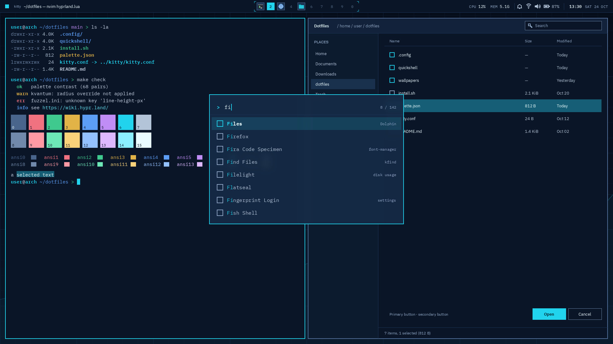
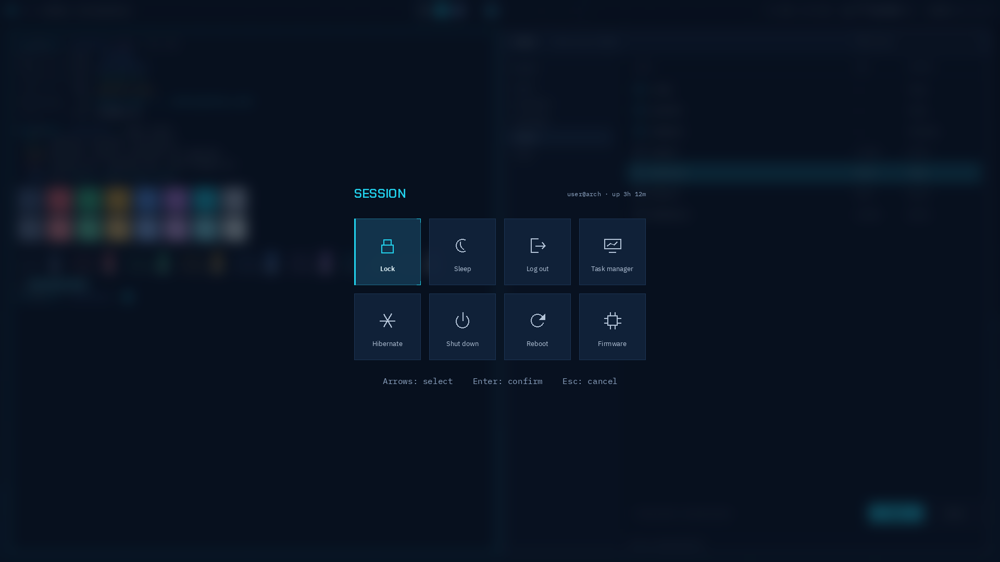
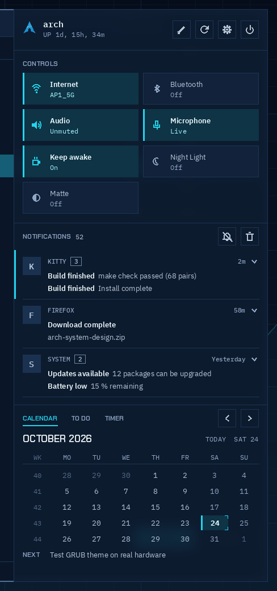
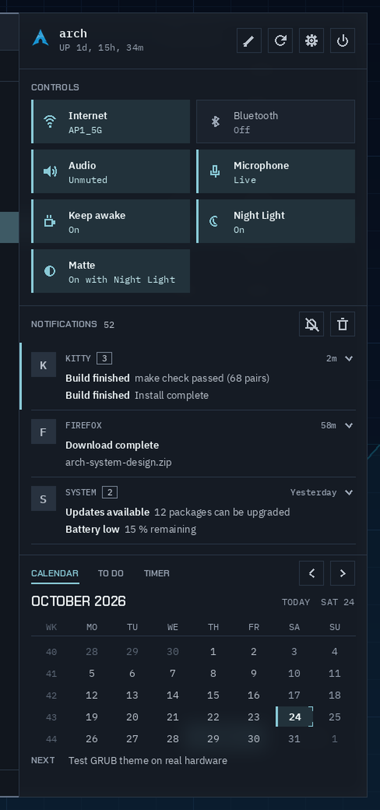
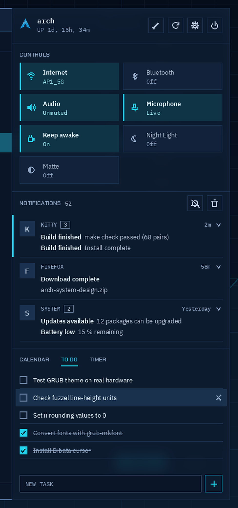
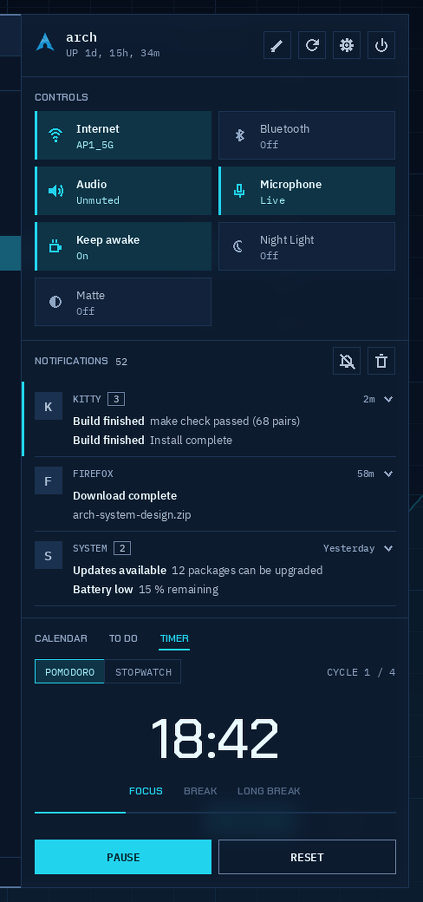

# Tickerline documentation

Tickerline is a theme for illogical-impulse ("ii", end-4's Hyprland dotfiles on Quickshell) plus a matching GRUB boot menu. Cyan on deep navy, square corners, monospace numbers, and a look taken from trading terminals and boot screens.

This document is the full reference: the design rules, every color and size, how each part of the desktop should look, how the scripts apply it, and what to watch out for when changing it. The [README](../README.md) covers installing and uninstalling. [NOTES.md](../NOTES.md) collects the implementation gotchas in short form.

## How to read this

- Section 1 is a quick reference. If you're an agent or in a hurry, start there.
- Sections 2 to 6 are the design spec. They describe the intended result, independent of how ii implements it.
- Section 7 is the GRUB theme.
- Section 8 explains how the scripts get the spec onto a running system, and section 9 lists the known limits.
- Colors are written as tokens in backticks (`surface-base`). The values live in `desktop/palette.json` and `desktop/palette-matte.json`; if a table here and the JSON disagree, the JSON wins.
- Sizes are in px on a 1920×1080 screen at scale 1 unless a unit says otherwise. Font sizes are in pt at 96 dpi (10 pt is about 13 px).
- File paths are relative to the repo root.

## Contents

1. [Quick reference](#1-quick-reference)
2. [Design rules](#2-design-rules)
3. [Color](#3-color)
4. [Shape, type and motion](#4-shape-type-and-motion)
5. [Desktop components](#5-desktop-components)
6. [Wallpaper](#6-wallpaper)
7. [GRUB boot menu](#7-grub-boot-menu)
8. [How it's built](#8-how-its-built)
9. [Known limits](#9-known-limits)

## 1. Quick reference

| Question | Answer |
| --- | --- |
| Source of truth for colors | `desktop/palette.json` (Default), `desktop/palette-matte.json` (Matte) |
| Source of truth for shape, motion, fonts | `desktop/palette.json` (`shape`, `motion`, `fonts`) |
| Script that applies everything | `desktop/apply-palette.py` (installed to `~/.local/share/tickerline/`) |
| One-time setup | `install.py` |
| Undo | `uninstall.py` (restores every `<file>.pre-tickerline`) |
| Runtime state | `~/.local/state/tickerline/matte` and `night`, each `on` or `off` |
| Tokens at runtime | `~/.local/state/quickshell/user/generated/ticker-tokens.json`, read by `TickerTokens.qml` |
| Hyprland settings | `desktop/hypr/tickerline.lua`, installed to `~/.config/hypr/custom/` |
| Replacement QML | `desktop/ii/` (bar, right sidebar, Matte toggle, Claude Code AI strategy) |
| Lock screen layout | `desktop/hyprlock.conf` |
| GRUB theme | `grub/boot-terminal/`, installed by `sudo grub/install.sh` |
| Mockups | `design/desktop/`, `design/sidebar/`, `design/grub/` |
| Contrast checks | `design/desktop/contrast.csv` (98 pairs, all pass) |
| Try changes safely | `dev/nested.sh` (nested Hyprland with its own home folder) |
| Restart the shell | `pkill -x qs`, then `hyprctl dispatch 'hl.dsp.exec_cmd("qs -c ii")'` |
| Shell log | `qs -c ii log` |

Rules that every change has to keep:

- Radius 0 everywhere. No shadows. No glow on live text.
- Cyan is the only accent. Green only means ready or OK.
- Components refer to tokens, never to a palette. Default and Matte have the same token names.
- Edit the repo, then rerun the script. Installed files under `~/.config` get overwritten.

## 2. Design rules

These hold for the boot menu and the desktop alike.

**One accent.** Cyan (`accent`, `#22D3EE` in Default) marks focus, selection, the active workspace and the primary action. Nothing else is cyan.

**Green means ready or OK.** Full battery while charging, a finished task, READY on the lock screen. It never decorates and is never a second accent, which is why the Material 3 `tertiary` role is pale cyan instead of green.

**Amber and coral only for real states.** `warning` and `error` show warnings and errors, nothing else.

**Square corners.** Every surface has radius 0. Where a corner needs attention it gets a bracket mark instead of rounding. Brackets (2 px thick, 16 px long, cyan) only appear on focal surfaces, places where your input goes: the lock panel, the selected session tile (small 8 px brackets, as in the GRUB highlight) and the workspace strip in the bar (6 px long, 1 px thick). Notifications, the OSD and menus get a 1 px `divider` border instead. Brackets stay rare so they keep their meaning.

**The GRUB highlight is the selection style.** A 10 % cyan fill, 1 px edges at 35 % cyan, a 3 px solid bar on the left and brackets on the right corners. Toolkits that can't draw that (fuzzel, GTK, Qt) use a flat fill: `selection-bg` for text and file selection, 14 % cyan for list rows.

**No glow, no shadow on live text.** Shadows are off on every layer. Blur is allowed only behind shell layers, and those stay 92 % opaque so text contrast barely changes.

**Two palettes, one set of roles.** Anything that would need a Matte-only exception is a missing token, not a special case.

**App icons sit in squares**, never circles: notification popups, the sidebar and the workspace cells.

**Uppercase labels use Chakra Petch** (section labels, the SESSION and AUTHENTICATE headers, the wordmark). Everything else uses IBM Plex Sans or BlexMono.

## 3. Color

### 3.1 Tokens

| Token | Default | Matte | Use |
| --- | --- | --- | --- |
| `surface-sunken` | `#060D1A` | `#0A0D13` | Deepest layer: lock screen field, overview backdrop |
| `surface-base` | `#0A1628` | `#11161E` | Desktop and window background, bar, terminal |
| `surface-low` | `#0D1B2F` | `#151B24` | Sidebars, side panes inside apps |
| `surface-raised` | `#11223A` | `#1B222D` | Cards, toolbars, session tiles |
| `surface-overlay` | `#152A45` | `#212A36` | Popups, menus, notifications, OSD, launcher |
| `surface-highest` | `#1A3250` | `#28323F` | Chips, occupied workspace, slider track |
| `surface-hover` | `#1A314E` | `#27313E` | Hover on any surface up to raised |
| `surface-pressed` | `#1E395B` | `#2D3948` | Pressed state |
| `text-primary` | `#EAFBFF` | `#F1F9FB` | Titles, body text, selected labels |
| `text-secondary` | `#B4C4D8` | `#BBC3CD` | Secondary lines, unselected list items |
| `text-muted` | `#8FA6C4` | `#9AA5B4` | Captions, metadata, hints |
| `text-disabled` | `#526986` | `#5D6877` | Disabled labels only (below 4.5:1 on purpose) |
| `accent` | `#22D3EE` | `#89C9D6` | Selection, focus, active workspace, links in the UI |
| `accent-hover` | `#67E8F9` | `#A7DEE6` | Accent under the pointer |
| `accent-active` | `#0FB5D0` | `#74ACB9` | Accent pressed |
| `focus-ring` | `#22D3EE` | `#89C9D6` | 2 px keyboard focus outline |
| `on-accent` | `#04222B` | `#142025` | Text and icons on a solid accent fill |
| `accent-container` | `#0E3446` | `#22323B` | Tinted fill: toggle on, selected chip |
| `on-accent-container` | `#A5F3FC` | `#C7EBF0` | Text on `accent-container` |
| `border-active` | `#22D3EE` | `#89C9D6` | Focused window border, launcher border |
| `border-inactive` | `#52709A` | `#617085` | Unfocused window border |
| `outline` | `#6C84A4` | `#778393` | Control borders: inputs, secondary buttons |
| `divider` | `#1C3554` | `#293544` | Hairlines and panel borders (decorative) |
| `success` | `#34D399` | `#82C6A6` | Ready or OK only |
| `on-success` | `#04222B` | `#122025` | Text on a `success` fill |
| `warning` | `#F5B83D` | `#DFBF86` | Low battery (15 %), updates waiting for a reboot |
| `on-warning` | `#2A1C00` | `#251E10` | Text on a `warning` fill |
| `error` | `#FF7A8C` | `#DD939A` | Errors, critical notifications, failed unlock |
| `on-error` | `#3A0610` | `#2E1416` | Text on an `error` fill |
| `error-container` | `#4A1622` | `#3D2126` | Error banner fill |
| `on-error-container` | `#FFD9DE` | `#F3DEE1` | Text on `error-container` |
| `selection-bg` | `#155E75` | `#3E5A65` | Text and file selection background |
| `selection-fg` | `#EAFBFF` | `#F1F9FB` | Text on a selection |
| `scrim` | `#060D1AB3` | `#0A0D13B3` | 70 % backdrop behind modal layers (8-digit hex) |

A few choices that aren't obvious from the table:

- `error` is coral, not pure red. Its warmth sits between the cyan and the amber, it stays clear of the accent in hue and lightness, and it keeps 4.5:1 on every surface up to `surface-highest`.
- `border-inactive` is brighter than a hairline because an unfocused window border has to reach 3:1 against the wallpaper behind it, including the lighter chart area. `divider` stays dim because it only decorates.
- `text-disabled` is below 4.5:1, which WCAG allows for disabled controls. Don't use it for anything you need to read.

### 3.2 Matte

Matte is the evening palette. Every hue stays where it is, saturation is roughly halved, and the surfaces move from navy toward a neutral slate.

| | Default | Matte |
| --- | --- | --- |
| Accent | `#22D3EE` cyan | `#89C9D6` muted teal-grey |
| Base surface | `#0A1628` navy | `#11161E` slate |
| Contrast checks | 98 pairs, all pass | 102 pairs, all pass |
| Closest ANSI pair | blue/magenta, ΔE 34.2 | blue/magenta, ΔE 23.6 |

How switching works:

| Rule | Behavior |
| --- | --- |
| Toggle | "Matte" tile in the right sidebar's CONTROLS grid, icon `contrast`. It replaces ii's Dark Mode toggle, since the theme is dark only |
| Night Light | Turning Night Light on also turns Matte on, on top of the color temperature change. The tile then reads "On with Night Light" |
| Live switch | No restart and no flash. Bar, sidebars, kitty, fuzzel, hyprlock, GTK and KDE change together |
| Unchanged | Shape, motion and fonts. Matte only swaps colors |

From a terminal: `python3 ~/.local/share/tickerline/apply-palette.py --matte toggle` (also `on`, `off`).

### 3.3 Contrast

Text needs 4.5:1 and UI borders 3:1 (WCAG AA). Every pair is in `design/desktop/contrast.csv` with columns `fg,bg,ratio,needs,kind,result`. Some anchors from the Default palette:

| Foreground | Background | Ratio |
| --- | --- | --- |
| `text-primary` | `surface-base` | 17.04:1 |
| `text-muted` | `surface-pressed` | 4.70:1 (the lowest text pair) |
| `accent` | `surface-highest` | 7.19:1 |
| `error` | `surface-highest` | 5.21:1 |
| `on-error` | `error` | 6.93:1 |
| `selection-fg` | `selection-bg` | 6.83:1 |
| `outline` | `surface-overlay` | 3.78:1 (border) |
| `border-inactive` | `surface-base` | 3.58:1 (border) |

`text-disabled` (2.08 to 3.45:1) and `divider` (1.16 to 1.46:1) are exempt: disabled and decorative.

The ratios assume a 92 % layer over the navy wallpaper. A bright window under a blurred popup lowers them a little. If text gets hard to read somewhere, raise the layer opacity to 0.96 rather than adding glow.

### 3.4 Material 3 mapping (ii)

ii reads Material 3 color roles. Each one maps to a token or, where no token fits, a literal hex. `m3` in the palette file holds the mapping; `m3_resolved` holds the hex values.

| M3 key | Token | Default | Matte | Why |
| --- | --- | --- | --- | --- |
| `background`, `surface` | `surface-base` | `#0A1628` | `#11161E` | |
| `surface_container_lowest`, `surface_dim` | `surface-sunken` | `#060D1A` | `#0A0D13` | The deepest navy of the GRUB gradient |
| `surface_container_low` | `surface-low` | `#0D1B2F` | `#151B24` | |
| `surface_container` | `surface-raised` | `#11223A` | `#1B222D` | |
| `surface_container_high`, `surface_variant` | `surface-overlay` | `#152A45` | `#212A36` | ii draws inputs and chips with `surface_variant`, so it sits above `surface_container` |
| `surface_container_highest`, `surface_bright` | `surface-highest` | `#1A3250` | `#28323F` | Dark only, so "bright" is the top surface step |
| `on_surface`, `on_background` | `text-primary` | `#EAFBFF` | `#F1F9FB` | |
| `on_surface_variant` | `text-muted` | `#8FA6C4` | `#9AA5B4` | |
| `primary`, `primary_fixed_dim`, `surface_tint` | `accent` | `#22D3EE` | `#89C9D6` | |
| `on_primary`, `on_primary_fixed`, `on_tertiary`, `on_tertiary_fixed` | `on-accent` | `#04222B` | `#142025` | |
| `primary_container` | `accent-container` | `#0E3446` | `#22323B` | |
| `on_primary_container`, `on_tertiary_container`, `primary_fixed`, `tertiary`, `tertiary_fixed_dim` | `on-accent-container` | `#A5F3FC` | `#C7EBF0` | Tertiary is a pale tint of the same cyan, never green |
| `secondary`, `secondary_fixed_dim` | `text-secondary` | `#B4C4D8` | `#BBC3CD` | Secondary is the neutral slate text tone, not a second hue |
| `secondary_container`, `tertiary_container` | `surface-highest` | `#1A3250` | `#28323F` | Neutral chips, so nothing brings in a third color |
| `on_secondary`, `on_secondary_fixed`, `inverse_on_surface` | `surface-base` | `#0A1628` | `#11161E` | |
| `on_secondary_container` | `text-primary` | `#EAFBFF` | `#F1F9FB` | |
| `inverse_surface` | `text-primary` | `#EAFBFF` | `#F1F9FB` | Tooltips and snackbars flip to near-white with navy text |
| `inverse_primary` | | `#0E7490` | `#4A6F7D` | A darker cyan keeps 4.5:1 on the light inverse surface |
| `on_primary_fixed_variant`, `on_tertiary_fixed_variant` | | `#0E5468` | `#36505A` | Text on `primary_fixed_dim` at 4.5:1 |
| `on_secondary_fixed_variant` | | `#2B4466` | `#384455` | Slate ink for text on `secondary_fixed` |
| `secondary_fixed` | | `#D3DEEB` | `#D8DDE4` | |
| `tertiary_fixed` | | `#CFFAFE` | `#E0F5F7` | |
| `outline` | `outline` | `#6C84A4` | `#778393` | |
| `outline_variant` | `divider` | `#1C3554` | `#293544` | Decorative hairline, like the GRUB panel border |
| `error` | `error` | `#FF7A8C` | `#DD939A` | |
| `on_error` | `on-error` | `#3A0610` | `#2E1416` | |
| `error_container` | `error-container` | `#4A1622` | `#3D2126` | |
| `on_error_container` | `on-error-container` | `#FFD9DE` | `#F3DEE1` | |
| `scrim` | | `#060D1A` | `#0A0D13` | Opaque here; the shell applies the 70 % alpha |
| `shadow` | | `#000000` | `#000000` | Shadows are off; black keeps any leftover invisible |

Because the light tooltips come from `inverse_surface`, they are intended, not a bug.

### 3.5 Terminal (kitty)

Colors 1 to 15 reach at least 4.5:1 on the background in both palettes. `ansi0` is the exception at about 3:1, because it's used for dim UI and as a background color, as in most palettes. The closest pairs (CIE76 ΔE, above 20 reads as clearly different) are blue/magenta at 34.2, green/cyan and blue/cyan at 47.5.

| # | Name | Default | Matte |
| --- | --- | --- | --- |
| 0 | black | `#4A658C` | `#54657D` |
| 1 | red | `#F0717F` | `#D5868B` |
| 2 | green | `#3FC98F` | `#77BF9B` |
| 3 | yellow | `#E2B347` | `#D3B77C` |
| 4 | blue | `#5C9DF5` | `#779ED4` |
| 5 | magenta | `#C08CF5` | `#B798D9` |
| 6 | cyan | `#22D3EE` | `#7ACBDC` |
| 7 | white | `#B4C4D8` | `#B9C3D0` |
| 8 | bright black | `#7189AA` | `#7A899D` |
| 9 | bright red | `#FF9AA5` | `#E7A8AE` |
| 10 | bright green | `#6EE7B7` | `#9ADDBF` |
| 11 | bright yellow | `#FAD27A` | `#EDD5A1` |
| 12 | bright blue | `#93C0FF` | `#A4C0E7` |
| 13 | bright magenta | `#DDB8FF` | `#D6BFEB` |
| 14 | bright cyan | `#8BEFFF` | `#AFE9F2` |
| 15 | bright white | `#EAFBFF` | `#EFFAFC` |
| | foreground | `#C9D6E6` | `#CFD5DD` |
| | background | `#0A1628` | `#11161E` |
| | cursor | `#22D3EE` | `#89C9D6` |
| | cursor text | `#0A1628` | `#11161E` |
| | selection background | `#155E75` | `#3E5A65` |
| | selection foreground | `#EAFBFF` | `#F1F9FB` |
| | url | `#67E8F9` | `#9AE1EB` |

## 4. Shape, type and motion

### 4.1 Shape and depth

| Property | Value | Notes |
| --- | --- | --- |
| Corner radius | 0 | Windows, bar, popups, buttons, inputs. No exceptions |
| Window border | 2 px, `border-active` or `border-inactive` | Hyprland has one global border width, so only the color changes |
| Gap between windows | 8 px | Hyprland `gaps_in = 4`, applied on each side |
| Gap to screen edge and bar | 16 px | `gaps_out = 16` |
| Bar height | 40 px | Flush to the top, full width, 1 px `divider` along the bottom |
| Grid | 8 px | Every size is a multiple of 8, except `gaps_in`, which produces an 8 px gap |
| Blur | Shell layers only | Bar, sidebars, notifications, OSD, fuzzel, session menu, overview. Size 8, 2 passes, noise 0, contrast 1, brightness 1, vibrancy 0, xray off. Never on windows |
| Shell layer opacity | 0.92 | On the background color only, never on text |
| Window opacity | 1.0 | Active and inactive alike. No dimming |
| Shadows | Off | Hyprland and ii |

### 4.2 Typography

| Role | Family | Arch package |
| --- | --- | --- |
| UI | IBM Plex Sans | `ttf-ibm-plex` |
| Monospace: terminal, numbers, launcher | BlexMono Nerd Font (Nerd-patched IBM Plex Mono, the GRUB face) | `ttf-ibmplex-mono-nerd` |
| Display: uppercase labels, clocks | Chakra Petch | Google Fonts (OFL), downloaded by `install.py` |
| ii icons | Material Symbols Sharp | ships with ii |
| Symbol fallback for GTK and Qt | Symbols Nerd Font Mono | `ttf-nerd-fonts-symbols-mono` |

Kitty, fuzzel and hyprlock use the glyphs built into BlexMono Nerd Font. ii draws its icons from Material Symbols, switched from Rounded to Sharp: same glyph names, square ends.

| Style | Family | pt | Weight | Used for |
| --- | --- | --- | --- | --- |
| caption | Plex Sans | 8 | 400 | Bar window class, timestamps |
| small | Plex Sans | 9 | 400 | Metadata, tooltips |
| body | Plex Sans | 10 | 400 | Default UI text |
| body-strong | Plex Sans | 10 | 600 | Notification title, primary button |
| title | Plex Sans | 11 | 500 | Window and panel titles |
| heading | Plex Sans | 13 | 600 | Sidebar section headings |
| section-label | Chakra Petch | 9 | 600 | UPPERCASE labels |
| display | Chakra Petch | 18 | 600 | SESSION and other large headers |
| clock-lock | Chakra Petch | 72 | 500 | Lock screen clock |
| mono-ui | BlexMono NF | 10 | 400 or 600 | Bar numbers (workspace digits at 9), OSD value |
| terminal | BlexMono NF | 11 | 400 | kitty |
| launcher | BlexMono NF | 12 | 400, selected 600 | fuzzel |

GTK and Qt use `IBM Plex Sans 10` and `BlexMono Nerd Font 10`.

### 4.3 Motion

One ease-out curve, nothing longer than 225 ms, no bounce or overshoot.

| Curve | cubic-bezier | Hyprland name |
| --- | --- | --- |
| `term` (enter, move) | `0.2, 0.0, 0.0, 1.0` | `term` |
| `term_exit` (leave) | `0.4, 0.0, 1.0, 1.0` | `termExit` |
| `linear` | `0, 0, 1, 1` | `termLinear` |

| What | ms | Curve | Style | Hyprland speed (1 = 100 ms) |
| --- | --- | --- | --- | --- |
| Window open | 200 | term | popin 96 % | 2.0 |
| Window close | 150 | term_exit | popin 96 % | 1.5 |
| Window move or resize | 200 | term | slide | 2.0 |
| Workspace switch | 225 | term | slide | 2.25 |
| Layers in (popups, OSD, notifications, sidebars) | 175 | term | slide and fade | 1.75 |
| Layers out | 125 | term_exit | fade | 1.25 |
| Fades | 150 | term | | 1.5 |
| Border color | 150 | linear | | 1.5 |

ii's own QML animations follow the same numbers: its "elementMove" family uses 200, 175 and 125 ms with `term` and `term_exit`, and spring or overshoot curves are replaced with `term`.

## 5. Desktop components

The mockups in `design/` show the target. The running theme is close to them, not pixel-identical.


### 5.1 Top bar

| Property | Value |
| --- | --- |
| Position | Top, full width, 40 px tall, no outer margin |
| Background | `surface-base` at 0.92 with blur, 1 px `divider` bottom edge with tick marks |
| Left | 12×12 cyan square (opens the left sidebar), window class (caption, `text-muted`), window title (body, `text-primary`) |
| Center | Workspaces 1 to 10 |
| Right, right to left | Date `SAT 24 OCT` (mono 9, muted), clock `13:30` (mono 10/600, primary), divider, battery %, battery icon lying flat with the terminal pointing right, volume, network, notifications, divider, `CPU 12%` `MEM 5.1G` (label mono 9 muted, value mono 10 primary), tray |
| Icons | 16 px, `text-secondary`, 16 px between modules |
| Dividers | 1×20 px `divider` between module groups |

Workspace cells are 24×24 px squares with an 8 px gap and BlexMono 9 pt numbers. The strip is framed by 6×1 px accent brackets.

| State | Fill | Border | Content |
| --- | --- | --- | --- |
| Active | `accent` | | Number in `on-accent`, 600 |
| Occupied | `surface-highest` | 1 px `border-inactive` | Icon of the biggest window on it, 16 px, full color |
| Empty | | | Number in `text-disabled` |
| Urgent | | 1 px `warning` | Icon, or the number if empty |

If an app has no icon in the icon theme, the cell shows its number in `text-secondary`.

### 5.2 Notification popup

| Property | Value |
| --- | --- |
| Position | Top right, 16 px below the bar and 16 px from the edge, stacked with 8 px gaps |
| Size | 400 px wide, height from content |
| Surface | `surface-overlay` at 0.92 with blur, 1 px `divider` border |
| Padding | 16 px |
| Header | 16 px app icon in a 24 px `surface-highest` square, APP NAME (BlexMono 8 pt/500, uppercase, `text-muted`), time on the right |
| Title | Plex Sans 10 pt/600, `text-primary` |
| Body | Plex Sans 10 pt, `text-secondary`, at most 3 lines |
| Actions | 96×32 px, 8 px apart. Primary: 1 px `accent` border, `accent` text. Secondary: 1 px `outline` border, `text-primary` text |
| Critical | 3 px `error` bar on the left, header text in `error`, never dismissed automatically |

### 5.3 Volume and brightness OSD

| Property | Value |
| --- | --- |
| Position | Centered, 16 px below the bar |
| Size | 320×56 px |
| Surface | `surface-overlay` at 0.92 with blur, 1 px `divider` |
| Content | 16 px icon inset 20 px, 4 px track in `surface-highest`, fill `accent`, 2×16 px `accent` thumb, value BlexMono 10/600 right-aligned and inset 20 px |
| Muted | Icon and value `text-muted`, fill `text-disabled` |
| Timeout | 1200 ms, then the 125 ms layer-out fade |

### 5.4 Launcher (fuzzel)



fuzzel can't draw 9-slices, so it gets the flat version of the highlight. Its 2 px cyan border matches the focused window border, since the launcher has keyboard focus. fuzzel writes colors as `rrggbbaa` without `#`.

| Property | Value | fuzzel key |
| --- | --- | --- |
| Size | 56 characters wide (about 610 px), 8 rows | `width=56`, `lines=8` |
| Row height | 40 px | `line-height=40px` |
| Padding | 24 horizontal, 16 vertical, 8 inner | `horizontal-pad`, `vertical-pad`, `inner-pad` |
| Font | BlexMono Nerd Font 12 pt, no DPI scaling | `font`, `dpi-aware=no` |
| Background | `surface-overlay` at 0.92 | `background` |
| Text, match | `text-secondary`, `accent` | `text`, `match` |
| Selected row | 14 % `accent`, text `text-primary`, match `accent` | `selection`, `selection-text`, `selection-match` |
| Prompt | `> ` in `accent`, input `text-primary` | `prompt`, `input` |
| Border | 2 px `accent`, radius 0 | `[border] width=2 radius=0` |
| Icons | Papirus-Dark | `icon-theme` |

### 5.5 Terminal (kitty)

| Property | Value | kitty key |
| --- | --- | --- |
| Font | BlexMono Nerd Font 11 pt | `font_family`, `font_size` |
| Margin | 0 | `window_margin_width 0` |
| Padding | 16 px | `window_padding_width 12` (kitty counts in pt) |
| Opacity | 1.0 | `background_opacity` |
| Colors | Section 3.5 | `color0` to `color15` and friends |

### 5.6 Lock screen (hyprlock)


The lock screen reuses the GRUB layout: the same top and bottom bars and the same panel construction. Positions are absolute, so it only lines up at 1920×1080.

| Element | Spec |
| --- | --- |
| Background | `wallpaper.png`, no blur |
| Top bar | 12 px `accent` square at x 64, then "BOOT//TERMINAL" in Chakra Petch 22 px `accent` at x 92, y 58. On the right, "SESSION LOCKED · 87% · " in mono 14 px `text-muted`, then "READY" in `success`, right-aligned at x 1856. Hairline at y 96 |
| Clock | `HH:MM` in Chakra Petch 72 pt/500, `text-primary`, centered at y 236. Date below in BlexMono 10 pt/500, uppercase, `text-muted`, y 312 |
| Panel | x 680 to 1240, y 400 to 600. `surface-low` at 0.92, 1 px `divider` border. A 56 px header in `#0E1E34` holds only "AUTHENTICATE" (Chakra Petch 17 px/600, `accent`); there is no user name. 18×2 px cyan brackets on all four corners, built from eight `shape` widgets |
| Input | 512×48 px, 24 px inside the panel and below the header. Inner `surface-base`, 2 px `accent` outline, rounding 0. Dots are 8 px squares, 12 px apart, `text-primary`. Check `accent`, fail `error`, caps lock `warning` |
| Hint | "Enter: unlock    Esc: clear", mono 16 px `text-muted`, centered 24 px below the input |
| Bottom bar | Hairline at y 1000 with ticks every 48 px. Left: host and uptime, mono 14 px `text-muted`. Far right: a 20 px user icon in `accent`, with now playing just left of it (empty when nothing plays) |
| User switch | Clicking the user icon asks GDM for a new login screen. The current session stays locked. The cursor stays visible for this |
| Alignment | Icons and the wordmark square are centered on the letters next to them, not on the text box |

### 5.7 Session menu



| Property | Value |
| --- | --- |
| Backdrop | Full-screen blur (size 8, 2 passes) plus `scrim` |
| Header | "SESSION" in Chakra Petch 18 pt/600 `accent`, 48 px above the grid. `user@host · uptime` in BlexMono 9 pt muted, right-aligned |
| Grid | 4×2 tiles of 128×128 px with 16 px gaps (560×272), centered |
| Order | Lock, Sleep, Log out, Task manager, then Hibernate, Shut down, Reboot, Firmware |
| Tile | `surface-raised` at 0.92, 1 px `divider`, 32 px icon in `text-secondary` at y+36, label Plex Sans 10 pt `text-secondary` at y+96 |
| Selected | GRUB highlight, icon `accent`, label `text-primary` 600 |
| Hint | "Arrows: select    Enter: confirm    Esc: cancel", mono 16 px `text-muted`, 40 px below the grid |
| Destructive actions | No special color. Enter confirms |

### 5.8 Right sidebar

| Default | Matte, with Night Light |
| --- | --- |
|  |  |

| Property | Value |
| --- | --- |
| Position | Right edge, 16 px below the bar and 16 px from the right and bottom |
| Size | 448 px wide, the remaining height (1008 px at 1080) |
| Surface | `surface-low` at 0.92 with blur, 1 px `divider` border |
| Padding | 16 px. Full-width 1 px `divider` lines between sections |
| Section labels | Chakra Petch 9 pt/600, uppercase, `text-muted` |

From top to bottom:

**Header** (72 px). Arch logo (24 px), host name in BlexMono 11 pt/600, uptime below it (`UP 1d, 15h, 34m`, BlexMono 9 pt muted). On the right, four 32 px square buttons 8 px apart: edit, reload, settings, power. Each has a 1 px `divider` border, a 16 px `text-secondary` icon and `surface-hover` on hover.

**CONTROLS.** Two columns of 204×56 px tiles with 8 px gaps: Internet, Bluetooth, Audio, Microphone, Keep awake, Night Light, Matte. Each tile has a 16 px icon inset 16 px, its name in Plex Sans 10 pt and a status line in BlexMono 9 pt (`AP1_5G`, `Unmuted`, `On with Night Light`). Left click toggles, right click opens the detail dialog.

| Tile state | Look |
| --- | --- |
| Active | `accent-container` fill, 3 px `accent` bar on the left, icon `accent`, name `text-primary` 600, status `on-accent-container` |
| Inactive | `surface-raised` fill, 1 px `divider` border, icon and status `text-muted`, name `text-secondary` |

The detail dialogs (Wi-Fi, Bluetooth, audio, Night Light) are square with a 1 px `divider` border, 16 px padding and a Chakra Petch uppercase title.

**NOTIFICATIONS.** The header shows the total count (BlexMono 9 pt, `text-secondary`) and 32 px mute and clear-all buttons. Notifications are grouped per app, groups separated by 1 px `divider` lines, and the list scrolls.

| Group part | Spec |
| --- | --- |
| Badge | 32 px `surface-highest` square with the app's icon (20 px). Apps without an icon get their first letter (BlexMono 11 pt/600, `text-secondary`) |
| Header | APP NAME (BlexMono 8 pt/500, caps, `text-muted`), count box (1 px `outline`), time, expand arrow |
| Lines | One per notification: bold summary (Plex Sans 10 pt/600, `text-primary`), then the body in `text-secondary`, cut off with … |
| Unread | 3 px `accent` bar along the panel's left edge, spanning the group |

**Tabs: CALENDAR, TO DO, TIMER.** Labels in Chakra Petch 9 pt/600 caps. The active tab is `accent` with a 2 px underline, the others `text-muted`. All three tabs share one fixed height: a 6-week calendar (tab row, month line, weekday header, 6 rows of 28 px, NEXT line). A 5-week month leaves an empty row under NEXT.

| Tab | Spec |
| --- | --- |
| Calendar | Month title in Chakra Petch 13 pt/600 caps. "TODAY SAT 24" on the right (BlexMono 9 pt muted) returns to the current month. 32 px prev and next buttons. ISO week column (`WK`, `text-disabled`), then Monday to Sunday in 28 px rows of BlexMono 10 pt: weekdays `text-secondary`, weekends `text-muted`, other months `text-disabled`. Today gets the GRUB highlight with a 700-weight number. The NEXT line shows the first open to-do item |
| To Do | 36 px rows with 1 px dividers. 16 px square checkbox: open is a 2 px `outline` border, done is an `accent` fill with an `on-accent` check. Done items are struck through, `text-muted` and sorted to the bottom. × on hover deletes. Below: a square input with the placeholder NEW TASK and a 36 px + button with an `accent` border |
| Timer | POMODORO / STOPWATCH switch (active: `accent-container`, 1 px `accent` border). `CYCLE 1 / 4` on the right. Time in Chakra Petch 48 pt/500, centered. FOCUS / BREAK / LONG BREAK in Chakra Petch 9 pt caps, current one `accent`. 2 px progress line. Full-width 40 px buttons: START and PAUSE filled `accent`, RESET and LAP outlined |

To Do and Timer sit on top of ii's own `Todo` and `TimerService`, so tasks and running timers carry over from plain ii.

| To Do | Timer |
| --- | --- |
|  |  |

### 5.9 Left sidebar: AI tab


The AI tab runs the local Claude Code CLI instead of a web API. It uses the Claude login, so there's no API key to set.

| Part | Behavior |
| --- | --- |
| Model picker | Claude Haiku, Sonnet, Opus |
| Mode picker | ask, edits, plan, full, mapped to Claude Code's `--permission-mode` values `default`, `acceptEdits`, `plan`, `bypassPermissions` |
| Sessions | One chat is one Claude session; later turns `--resume` it. `/clear` or loading a saved chat starts a new one |
| Permissions | Tool calls that Claude Code's settings don't allow show Approve and Reject buttons. Approve allows it for the rest of the session: the exact command for shell calls, the whole tool otherwise |
| Missing CLI | If `claude` isn't on the PATH, the tab says so |
| Removed | The Anime tab, the tab bar (when only the AI tab is left) and the key and temperature status row |

The protocol details are in [NOTES.md](../NOTES.md#sidebar-ai-claude-code).

### 5.10 Shortcuts

| Keys | Action |
| --- | --- |
| Super + H | ii's cheat sheet. Added because Super + / needs Shift on some layouts (German, for one) |
| Super + Shift + Alt + right click | Sends the selected text to the AI tab with a summary prompt, always on Haiku and in the text's language. Apps that don't publish their selection fall back to the clipboard |

### 5.11 GTK, Qt and KDE apps

| App | Approach |
| --- | --- |
| GTK 3 | `~/.config/gtk-3.0/gtk.css` with `@define-color` values from the tokens and `* { border-radius: 0; }` |
| GTK 4 / libadwaita | The same `@define-color` names in `~/.config/gtk-4.0/gtk.css` (`accent_bg_color`, `window_bg_color`, `headerbar_bg_color`, `card_bg_color`, `popover_bg_color`, `dialog_bg_color`, `sidebar_bg_color`, `destructive_bg_color`, `success_color`, `warning_color`, `error_color`) |
| KDE and Qt (Dolphin and others) | A KDE color scheme per palette, `Tickerline` and `TickerlineMatte`. Window and view `surface-base`, buttons and headers `surface-raised`, selection `selection-bg`, tooltips `surface-overlay`. Links `accent-hover`, negative `error`, neutral `warning`, positive `success` |
| Fonts | IBM Plex Sans 10 and BlexMono Nerd Font 10, through gsettings, `kdeglobals` and fontconfig |

### 5.12 Cursor and icons

| What | Choice | Why |
| --- | --- | --- |
| Cursor | Bibata-Original-Classic, 24 px, installed to `~/.local/share/icons` from the Bibata GitHub release | "Original" has sharp tips, "Classic" is dark with a light outline. The AUR package would clash with ii's Bibata package |
| Icons | Papirus-Dark, optionally with cyan folders (`papirus-folders -C cyan --theme Papirus-Dark`) | Flat, squarish, and the cyan folders pick up the accent |

## 6. Wallpaper

`desktop/wallpaper.png` is 1920×1080, 8-bit RGB. It is the GRUB background without the panel, the top and bottom bars and all text: the same gradient, the 48 px grid with major lines every 240 px, the soft cyan bloom, the price chart and the last-price line. Booting from GRUB into the desktop looks like the panel and text bars fading out of the same scene.

## 7. GRUB boot menu


A static menu for a dual-boot PC (Arch Linux and Windows), drawn for exactly 1920×1080. No countdown, no animation. `design/grub/mockup_main.png` is the target and `mockup_advanced.png` shows the Advanced options submenu at its 5-row maximum.

### 7.1 What GRUB draws and what is baked in

| Layer | Drawn by | Contents |
| --- | --- | --- |
| `background.png` | Baked | Gradient, grid, price chart, top bar ("BOOT//TERMINAL", "NODE 01 · UEFI x86_64 · READY"), bottom bar, the whole panel frame with its SELECT BOOT TARGET header, corner brackets, dotted guides between rows |
| `boot_menu` | GRUB | Entry labels, icons, selection highlight |
| `label` | GRUB | `Enter: boot    e: edit entry    c: console` |

The panel frame is in the background, so `menu_pixmap_style` stays unset.

### 7.2 Layout

The design numbers and the values that make GRUB actually draw them differ, because of how GRUB places the 9-slice highlight. Both are listed. The theme file uses the right-hand column.

| Property | Design | `theme.txt` | Why they differ |
| --- | --- | --- | --- |
| Menu left / top | 544 / 360 | 544 / 360 | |
| Menu width | 832 | 834 | GRUB takes 2 px off when it computes the highlight width |
| Menu height | 352 (5 rows) | 352 | |
| Row height | 64 | `item_height = 48` | The top and bottom slices (8 px each) are drawn outside `item_height` |
| Gap between rows | 8 | `item_spacing = 24` | Keeps the 72 px row pitch |
| Padding | | `item_padding = 0` | Padding shifts the whole list right and down |
| Highlight edge to icon | 20 | left slices 20 px wide | GRUB puts the icon right after the left slice |
| Icon | 40×40 | 40×40 | |
| Icon to label | 16 | `item_icon_space = 16` | |
| Scrollbar | off | off | |

Row *n* (counting from 0) starts at y = 360 + n × 72, so the rows fall between the dotted guides at y 427, 499, 571 and 643. The baked panel spans x 520 to 1400 and y 288 to 728, with the header from y 288 to 344. The hint line sits at y 760, 24 px tall, full width, centered.

### 7.3 Selection highlight

Nine slices, `select_*.png`, 8-bit RGBA. The corners and right edge are 8×8 px. The three left slices (`select_nw`, `select_w`, `select_sw`) are 20 px wide; the extra 12 px repeat each slice's inner column, so the left bar and border look the same while the icon gets its 20 px inset.

- Center: `#22D3EE` at 10 % alpha
- Top, bottom and right borders: 1 px `#22D3EE` at 35 %
- Left: a 3 px solid `#22D3EE` bar, full height
- Right corners: 8 px L-brackets in solid `#22D3EE`
- The outer edge covers x 544 to 1376 and the full 64 px row

### 7.4 Fonts and colors

| Use | Font in `theme.txt` | Color |
| --- | --- | --- |
| Entry | `IBM Plex Mono Regular 22` | `#8FA6C4` |
| Selected entry | `IBM Plex Mono SemiBold Regular 22` | `#EAFBFF` |
| Hint line | `IBM Plex Mono Regular 16` | `#7D95B5` |
| Fallback background (`desktop-color`) | | `#0A1628` |

Contrast: entries 7.2:1 on the panel, the selected entry 13.8:1 on the highlight, the hint 5.1:1 on the background. Chakra Petch and the 14 px status text only appear inside `background.png`.

`grub-mkfont` only knows Regular and Bold, so a SemiBold file converted plainly gets the name `IBM Plex Mono Regular 22`, the same as the Regular file. `grub/build-fonts.sh` therefore passes `-n "IBM Plex Mono SemiBold"`, which produces the name `IBM Plex Mono SemiBold Regular 22`. If a name in `theme.txt` doesn't match a loaded font, GRUB silently uses its default font. `strings file.pf2 | grep -m1 Plex` shows the name inside a file.

### 7.5 Icons

Icons map by entry class: `icons/arch.png` for `--class arch`, `icons/windows.png` for `--class windows` (os-prober sets that). Entries with other classes get no icon; copy or rename a file to match. "Advanced options" has no icon, and its label still lines up with the others.

### 7.6 Install and preview

`sudo grub/install.sh` finds the GRUB folder (`/boot/grub`, `/efi/grub` or `/boot/efi/grub`), copies the theme to `themes/boot-terminal/`, builds the fonts, sets these keys in `/etc/default/grub` and runs `grub-mkconfig`:

```
GRUB_THEME="<grub dir>/themes/boot-terminal/theme.txt"
GRUB_GFXMODE=1920x1080,auto
GRUB_GFXPAYLOAD_LINUX=keep
GRUB_TIMEOUT_STYLE=menu
```

The old file is kept once as `/etc/default/grub.pre-tickerline`. `GRUB_TIMEOUT` isn't touched; set it to `-1` if you want the menu to wait without a countdown, as in the design.

`grub/preview.sh` packs the theme and `grub/preview.cfg` into a standalone GRUB EFI binary, boots it in QEMU with OVMF at 1920×1080, presses the given keys and saves `grub/shot.png`. It runs headless in about 20 seconds.

```
grub/preview.sh              # main menu
grub/preview.sh "down"       # second entry selected
grub/preview.sh "down ret"   # Advanced options submenu
```

Two things `preview.cfg` needs that a real `grub.cfg` already has: one `loadfont` line per font (a `*.pf2` glob needs `insmod regexp`, and without fonts GRUB falls back to 8 px Unifont), and `export theme`, or submenus open in text mode on a black screen.

### 7.7 Rules for the artwork

- One accent hue. Cyan means selected or frame. Green appears once, on READY. No red.
- Square edges, with brackets at corners.
- No shadow, glow or transparency on live text. Any glow is baked into the background.
- PNGs must be 8-bit RGB or RGBA. GRUB can't read indexed or palette PNGs; with ImageMagick, write with a `PNG32:` prefix.

## 8. How it's built

### 8.1 Install

`install.py` checks the requirements (ii present, Hyprland on the Lua config, kitty, fuzzel, hyprlock, the fonts, Papirus) and prints the `pacman` command for anything missing. Then it:

1. copies `desktop/` and `uninstall.py` to `~/.local/share/tickerline/` and the wallpaper to `~/.local/share/backgrounds/tickerline.png`
2. downloads Chakra Petch and the Bibata cursor if they aren't there yet
3. writes `~/.config/hypr/custom/tickerline.lua` and loads it from `custom/general.lua`
4. sets kitty, fuzzel and fontconfig values, GTK fonts and icons (gsettings) and KDE fonts (`kwriteconfig`)
5. edits ii's `config.json`: matugen off, fonts, transparency 0.92, flat bar, numbered workspaces, hyprlock, wallpaper, the Dark Mode toggle shown, the Anime tab off, no extra AI models
6. runs `apply-palette.py` and restarts Quickshell

Before changing a file for the first time, it saves the original as `<file>.pre-tickerline`. Running it again is safe. The installed copy doesn't depend on the clone, so the clone can be moved or deleted afterwards.

Without git, the source archive (without `design/` and `dev/`) is enough:

```
curl -L https://github.com/luto2/Tickerline/archive/refs/heads/main.tar.gz | tar xz
```

Tagged releases have the same archive under `archive/refs/tags/<tag>.tar.gz`.

### 8.2 apply-palette.py

```
apply-palette.py                  reapply everything with the saved state
apply-palette.py --matte toggle   Matte on or off (also: on, off)
apply-palette.py --night on|off   called by ii's Night Light; on forces Matte
```

The Matte palette is active when either `matte` or `night` in `~/.local/state/tickerline/` is `on`. Each run writes:

| Target | Contents |
| --- | --- |
| `~/.local/state/quickshell/user/generated/colors.json` | M3 colors for ii, reloaded live |
| `generated/material_colors.scss` | For ii's terminal scripts |
| `generated/ticker-tokens.json` | All tokens plus `_variant`, `_matte`, `_night`; read live by the bar, sidebar and Matte toggle |
| `generated/terminal/kitty-theme.conf` | kitty colors |
| `~/.config/hypr/hyprland/colors.lua` | Border and background colors |
| `~/.config/hypr/hyprlock.conf`, `hyprlock/colors.conf` | Lock screen layout, every token as `$name` |
| `~/.config/fuzzel/fuzzel_theme.ini` | Launcher colors |
| `~/.config/gtk-3.0/gtk.css`, `gtk-4.0/gtk.css` | From ii's matugen templates, plus libadwaita pins |
| `~/.local/share/color-schemes/Tickerline[Matte].colors` | KDE and Qt scheme |
| ii's QML | Radius 0 with spacing put back, Sharp icons, no shadows, square notification icons, dialog styling, the replacement bar and sidebar, the Matte toggle, the Night Light hook, the Claude Code AI tab |

Then it reloads Hyprland, kitty (SIGUSR1), the Plasma color scheme and KDE's icon cache.

ii uses its rounding values as padding in many places, so zeroing them would also remove padding. The script puts fixed spacing back wherever a rounding value is used as a margin or padding (`SPACE` in the script: 4, 8, 12, 16 or 24 px).

In the replacement QML, a quoted `"{{token}}"` becomes `(TickerTokens.t["token"] ?? "transparent")`. `TickerTokens` watches `ticker-tokens.json`, which is why switching palettes needs no restart.

**ii updates overwrite the patched files.** After every dots-hyprland update, run `python3 ~/.local/share/tickerline/apply-palette.py`.

### 8.3 Uninstall

`uninstall.py` moves every `.pre-tickerline` file back, deletes the files the theme added, and removes its line from `custom/general.lua`. Fonts, the cursor and font settings stay. Afterwards restart the shell and pick a wallpaper in ii so matugen recolors everything. If ii was updated after the install, the backups of ii's files are older than the update; run ii's update again.

GRUB: `sudo cp /etc/default/grub.pre-tickerline /etc/default/grub && sudo grub-mkconfig -o /boot/grub/grub.cfg`. If the theme ever breaks, GRUB shows its plain text menu and still boots.

### 8.4 Working on the theme

`dev/nested.sh` starts a second Hyprland as a window inside the running session, with its home folder at `local/dev-home` (ignored by git). It copies dots-hyprland's config on the first run, links your fonts and icons, runs `install.py` with stubbed reload commands and a private D-Bus session, then starts Hyprland. Every start reinstalls the repo's current state; `--reset` starts over.

The nested session can't test the lock screen, idle or GRUB, and keybinds the outer Hyprland already uses won't reach it. Use `grub/preview.sh` for the boot menu.

Things that waste time if you don't know them (more in [NOTES.md](../NOTES.md)):

- Quickshell only loads new or renamed QML files after a full restart. After a failed reload it can keep running a stale copy, and its errors then point at code that no longer exists.
- In ii components, avoid a property called `active` on a MouseArea component, anything named `data`, an id called `bottom`, and inline component names that clash with ii widgets (prefix them with `Ticker`).
- A plain file path as an `IconImage` source needs a `file://` prefix.
- kitty padding is in pt, fuzzel scales fonts by DPI unless `dpi-aware=no`, and hyprlock reads `#` as a comment (write `##RRGGBB` in label text).

## 9. Known limits

- GTK4 and libadwaita keep small rounded corners on some buttons and dialogs. A stylesheet can't reach all of them, and libadwaita isn't patched.
- The lock screen and the boot menu use pixel positions for 1920×1080. On other resolutions they don't line up. The desktop itself works at any resolution.
- The boot panel fits 5 rows. More entries scroll inside it, without a scrollbar.
- The lock screen's user switch only works with GDM.
- ii updates undo the QML patches until `apply-palette.py` runs again.
